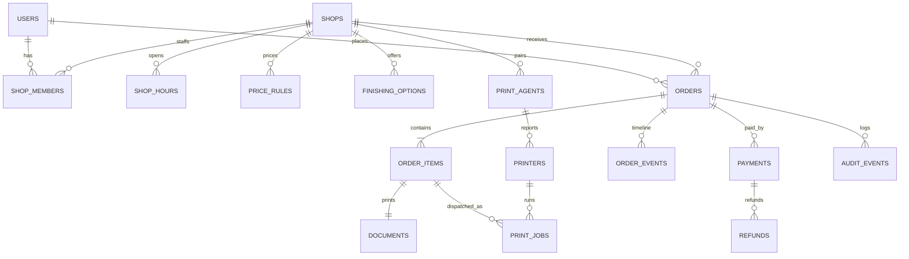
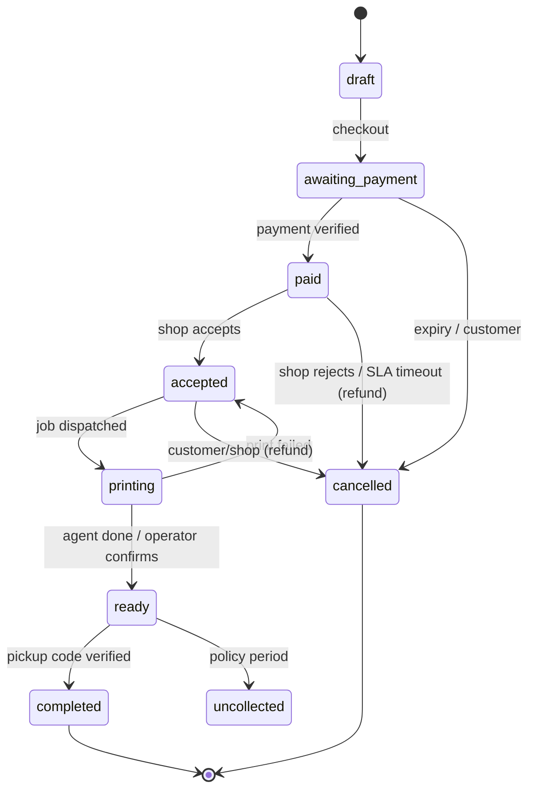

# Product & Architecture Review — Privacy‑First Smart Printing Platform

Status: **Draft for approval** · Date: 2026‑11‑20 · Working name: **Quire** (a quire is a gathering of printed sheets; placeholder until you pick a name)

This document is the agreed foundation before any code is written. Sections 1–10 follow the "First Task" list from the brief. Section 11 is the proposed visual direction; Section 12 lists the open decisions.

---

## 1. Analysis of the concept

The brief combines three products:

| Problem | What actually solves it | Hard part |
|---|---|---|
| Messy shop order handling (WhatsApp/email/pen‑drive chaos) | A structured queue with settings, price and payment attached to every job | Getting shops to change habits — the queue has to be **faster** than WhatsApp |
| Sensitive documents leaking at shops | Keeping originals **off the shop's disk and inbox**, deleting them on schedule, and logging every access | Being honest: we cannot stop a determined operator from copying what they print |
| Having to visit the shop just to submit and pay | Remote ordering + prepayment + a pickup code | Shop reliability (closed/offline shops after a customer has paid) |

**The real privacy problem is accumulation, not theft.** The common leak at an Indian print shop is not an operator stealing one Aadhaar card. It is the shop PC's `Downloads` folder, WhatsApp Desktop history and Gmail inbox holding years of customers' Aadhaar, PAN, bank statements and marksheets. Anyone who later uses, repairs, steals or infects that PC can read them. A platform removes most of the real‑world risk if it does three things. First, the shop never receives the **original uploaded file** as a normal, saveable document in the Protected workflow: nothing appears in Downloads, a chat, or an inbox. Second, the temporary **print‑spool data** that Windows writes while printing is limited and disclosed (§4.3). Third, the original is deleted from the platform within hours. That is the value proposition we can honestly promise. "Impossible to copy" is not, and neither is "never touches the shop's disk" (see §4.3).

**Where I'd challenge the brief**

1. **Protected Printing should not wait until Phase 2.** It is the differentiator. Phase 1 should include all the server‑side protection: no original bytes ever reach a shop browser in Protected mode, watermarked image previews, short‑lived access, audit log and auto‑deletion. It should also include a print agent that uses the real protocol but simulates the printer. Phase 2 swaps the simulated printer for real Windows printing.
2. **Multi‑shop isolation is not Phase 3.** Tenant isolation is cheap to build on day one and expensive to retrofit. Phase 1 needs shop discovery anyway. Phase 3 becomes map/geo discovery and networks.
3. **One order = one document is too narrow.** Customers routinely print 3–5 files at once ("resume + 2 certificates + Aadhaar"). An order should hold multiple **items**, each with its own document and settings, and one payment.
4. **The "Received by shop" status adds nothing for customers.** Once payment is confirmed the order *is* in the shop's queue. The value lies in *Accepted* (a human acknowledged it). I propose collapsing the two (see §8 state machine).
5. **Shops without a print agent must not accept Protected orders.** Without the agent, the only way to print is through the browser, and the browser can always "Save as PDF". Rather than silently weakening the promise, shops display a **"Supports Protected Printing"** badge, and Protected mode is offered only at shops that have it.
6. **Walk‑in customers will not sign up at the counter.** The "physically present" journey needs a shop counter QR → phone OTP → upload → pay in under a minute. Full account creation must not be a prerequisite.
7. **DOCX/PPTX support is a fidelity trap.** Server‑side conversion (LibreOffice) changes fonts and layout and miscounts pages, which causes pricing disputes. MVP: PDF + JPG/PNG. Office formats come later, converted to PDF *and shown to the customer for approval* ("this is exactly what will print").

---

## 2. Missing requirements

**Ordering & pricing**
- Pricing model: per‑side price by (paper size × colour), separate double‑sided sheet price, per‑copy finishing fees, optional minimum order charge. Store everything in integer paise and keep a price snapshot on each order item.
- Price is computed **only on the server**. The client shows the server's quote; the payment amount always comes from the database.
- Mixed‑colour documents: MVP charges the whole item as colour or B&W. Later: detect colour pages and charge per page.
- Limits: max file size (50 MB), max pages per item (500), max items per order (10). Bulk printing (Phase 3) is a separate flow.
- Shop capacity and ETA: the shop sets an "estimated ready" time on accept. Otherwise there is no ETA.
- GST invoice/receipt per order (shop's GSTIN optional).

**Shop operations**
- Staff accounts with roles (Owner vs Operator). Every action is attributed to a person, not just "the shop".
- Order acceptance SLA: if a paid order isn't accepted within N minutes (shop‑configurable, default 20), it is auto‑cancelled with a refund.
- Pause/"Not accepting orders" toggle, separate from Open/Closed (busy shops need this).
- **Pickup verification:** a 4‑digit pickup code or a scan of the customer's order QR is required to mark an order Completed. This prevents handing a stranger someone's Aadhaar printout.
- Reprint after paper jam or damage without charging the customer again (the original must still exist → the recovery window).
- Handling uncollected physical prints (outside platform control; the shop policy is shown to customer).

**Customer**
- Guest/quick checkout via phone OTP.
- Notifications: in‑app plus email in MVP; SMS/WhatsApp Business later (paid providers).
- "Delete my document now" at any time after printing (and before, which cancels the order).
- An **access receipt** on every order: the customer sees exactly who did what with their file, e.g. "Previewed page 1 · 10:42 · Operator Ravi", "Sent 2 copies to HP LaserJet · 10:44", "File permanently deleted · 12:44". This is the most persuasive privacy feature and costs little, because we need the audit log anyway.
- Support/dispute path (wrong print, poor quality → partial refund by the shop).

**Platform**
- Platform admin (minimal): verify shops, suspend abusive accounts. MVP: a seed script plus DB flags, not a UI.
- Terms/acceptable use (no bulk copyrighted books, no illegal content). The platform does **not** inspect document content.
- Compliance posture: design toward India's DPDP Act 2023 principles (notice, consent, purpose limitation, erasure, breach notification). This is not legal advice; real launch needs a review.

**Filenames are personal data.** `Aadhaar_Ramesh_Kumar.pdf` reveals what the document is. Store filenames encrypted. In Protected mode shops see "Document 1 · PDF · 3 pages" unless the customer chooses to show the name.

---

## 3. Technical feasibility issues

| Requirement | Reality | Resolution |
|---|---|---|
| "Website prints protected document without the shop getting a copy" | A web page cannot choose a printer, print silently, or keep bytes away from the device. Anything a browser can print, it can also "Save as PDF" (the print dialog offers it), and the bytes are visible in DevTools | Protected printing needs a **local print agent**. Browser printing is used only for Download‑Permitted orders |
| Silent printing | Only via the agent (or Chrome `--kiosk-printing`, which still exposes the bytes) | Agent |
| Stop screenshots/photos | Impossible: OS screenshots, phone cameras, screen recorders | Disclose honestly. Reduce exposure: previews are low‑resolution, watermarked and per‑page, only when needed |
| Guarantee deletion everywhere | Backups, replicas, spool files, forensic recovery on disk | **Crypto‑shredding** (§5) for platform copies; disclose what we cannot control on the shop PC |
| Know the paper physically came out | The spooler reports "sent/printed", not "the page left the tray intact" | Agent reports spooler completion; the operator confirms Ready |
| Accurate page counts for pricing | Fine for PDF/images; unreliable for DOCX before conversion | MVP: PDF + images only |
| Malware scanning | ClamAV works but is heavy (~1–2 GB RAM) and misses targeted PDFs | ClamAV (optional in dev, visibly marked "scan skipped") **plus** structural sanitisation. In Protected mode the operator never opens the original; the agent rasterises it |
| Razorpay webhooks on localhost | Webhooks need a public URL | Verify the checkout signature server‑side + a reconciliation poll. Also a clearly labelled **Mock gateway** so the app runs without keys |
| Real payouts to shops | Platform collecting money for shops = marketplace settlement (Razorpay Route, shop KYC) | Out of scope for prototype; test mode only. Decision needed (§12) |
| Windows agent distribution | Unsigned installers trigger SmartScreen; needs auto‑update | Phase 2: code signing, MSI, auto‑update |

---

## 4. How protected printing can realistically work

### 4.1 Architecture options

| # | Approach | What reaches the shop PC | vs. casual copying | vs. a determined operator | Cost / complexity | Reliability | Verdict |
|---|---|---|---|---|---|---|---|
| 1 | Browser prints the original PDF | Original bytes in browser memory/cache; print dialog offers "Save as PDF" | ❌ Same as a download | ❌ | Low | Medium (manual dialog each job) | **Only for Download‑Permitted orders** |
| 2 | Browser prints server‑rendered page images | Rasterised pages; still "Save as PDF"‑able | ⚠️ Slight friction (no text layer) | ❌ | Low–Med | Medium; large images, quality varies | Not offered as "Protected" — it would be misleading |
| 3 | **Local print agent** (authenticated service on the shop PC) | Original decrypted **in agent memory** and rendered to an **approved physical printer**. The original is not saved as a file. Windows writes **temporary print‑spool data** to disk until the job finishes (§4.3) | ✅ No file, no download, no Save‑as‑PDF | ⚠️ Raises the bar but doesn't stop admin‑level tooling (memory dumps, spooler capture, fake "physical" printers) | Med–High (installer, signing, updates, drivers) | High; automatic status reporting | **Recommended** |
| 4 | Cloud → printer directly (IPP over internet) | — | — | Exposes printers to the internet | High; shops' printers are rarely IPP‑capable or reachable | ❌ Rejected |
| 5 | Buy, don't build (PrintNode / ezeep‑style agent services) | Like #3 but files transit a third party | ✅ | ⚠️ | Low build cost, per‑printer fees, adds a data processor | High | A good fallback if building the agent stalls |
| 6 | Enterprise secure‑release printing (PaperCut, MFP pull printing) | Held on print server / MFP | ✅ | ⚠️ | Expensive per shop | High | Not for small shops |

### 4.2 Recommended MVP design

- **Phase 1:** the full agent protocol (pairing, job dispatch, one‑time payloads, status reports) with an agent that runs in **Simulated** mode. Every simulated job is labelled `SIMULATED — no paper printed` in the UI, the logs and the access receipt.
- **Phase 2:** the same agent gets a Windows printing backend (Python prototype: `pypdfium2` to render + `pywin32` to the GDI printer; production rewrite in .NET or Go for memory hygiene and signing).

### 4.3 What actually happens to the document (agent path)

```
Customer browser ──TLS──► API ──► validate, sanitise, page‑count ──► encrypt (per‑doc key) ──► object storage (ciphertext)
                                                                                   │
Operator clicks "Print" on order ──► API creates print_job (printer, copies) ──────┘
                                         │
Agent (outbound connection only) ◄──── job notification
Agent ──► GET /agent/jobs/{id}/payload  (one‑time token, ~60 s TTL, bound to this agent's credential)
API decrypts in memory ──TLS stream──► Agent RAM
Agent: refuses virtual/file printers, renders pages ──► Windows spooler ──► printer
Agent ──► reports copies/pages sent, errors ──► API ──► access receipt + order status
```

Where copies of the content exist, and for how long:

| Location | What | Lifetime | Mitigation |
|---|---|---|---|
| Object storage | Ciphertext | Until retention purge (§5.3) | Bucket not versioned and not backed up. Purge deletes every object under the document's prefix; its epoch key is destroyed later (see [docs/03](03-retention-and-deletion.md)) |
| API server memory | Plaintext during processing/streaming | Seconds | No plaintext temp files; processing in memory or tmpfs, wiped |
| Agent memory | Plaintext | Duration of the job | Best‑effort zeroing (limited in Python → a reason for a compiled agent later) |
| **Windows spooler** (`C:\Windows\System32\spool\PRINTERS`) | Rendered job (.SPL/.SHD), **on disk** | Until the printer consumes the job, then deleted. Kept forever if the printer has "Keep printed documents" on | Agent checks the printer attribute and refuses printers that keep jobs. Recommend BitLocker on the shop PC. Deleted spool files can be forensically recoverable — disclosed |
| Printer / MFP internal storage | Many office MFPs keep job images on an internal disk | Device‑dependent | Outside our control; disclosed. Shops can enable image overwrite on supported MFPs |
| Browser (Download‑Permitted only) | Original file, in cache/Downloads | Until the operator deletes it | `Cache-Control: no-store`; the download is logged; customer explicitly consented |

#### Original file vs. temporary print‑spool data

These are two different things, and our claims treat them separately:

| | Original uploaded file | Temporary print‑spool data |
|---|---|---|
| What it is | The exact PDF/image the customer uploaded, a complete reusable document | Windows' rendered version of the print job (EMF/XPS or printer language such as PCL/PostScript) in `.SPL`/`.SHD` files |
| Written to the shop PC's disk? | **No**, in the Protected workflow. It exists only in the agent's memory during the job | **Yes, temporarily.** Every Windows print job is spooled to disk |
| Normally visible to the operator? | No: no download button, no file in Downloads/Desktop, no "Save as" | No: it sits in a protected system folder that needs administrator rights |
| Normal lifetime | Seconds (memory only) | Until the printer has received the job, typically seconds to minutes. Longer if the printer is offline or the queue is paused |
| Can it outlive the job? | Only through admin‑level tools (e.g. memory dump) | Yes, if "Keep printed documents" is on (the agent refuses such printers). Deleted spool files may also be forensically recoverable from an unencrypted disk until overwritten |
| Can it be turned back into a usable document? | — | Often yes, with specialist tools. It is printable content, though not the original file |

**Accurate claim:** "In Protected mode, the shop doesn't receive your original file as a downloadable document. To print it, Windows temporarily stores print data on the shop's computer and normally removes it when printing finishes." **Claims we never make:** "never stored on the shop's computer", "leaves no trace", "impossible to copy".

**Spool‑data mitigations (Phase 2 agent):** refuse printers with "Keep printed documents" enabled. Send each job only when the printer reports ready, so jobs don't sit in a paused queue. After each job, confirm the spooler has removed it and report any job still queued to the dashboard ("Job stuck in Windows queue — clear it"). Recommend BitLocker so a stolen or repaired PC doesn't expose deleted spool files. The agent cannot securely wipe spool files itself (they are owned by the Windows spooler), and we say so.

**Printer allowlist.** The agent reports printers with driver and port. It rejects ports such as `FILE:`, `PORTPROMPT:` and `nul:`, plus known virtual drivers (Microsoft Print to PDF, XPS Document Writer, OneNote, and any "PDF" printer). The shop explicitly registers which physical printers may receive jobs. A determined admin can still install a fake driver that writes files. The protection is friction and a log, not prevention.

**Copies are enforced.** The agent prints exactly the paid number of copies. Reprints create a new logged job (with an operator reason), visible on the customer's access receipt.

### 4.4 Previews in Protected mode

- Rendered **server‑side** to low‑resolution WebP (~100 dpi). The default is page thumbnails. A larger view is available per page on request.
- Watermarked diagonally with `Order PF‑…· Shop QX7K · Preview only`, plus the operator name and timestamp.
- Served through an authorised, session‑bound endpoint with `no-store`, never as a public or shareable URL. Every preview fetch is audit‑logged.
- The printed output is **not** watermarked (customers need clean copies). As an optional later feature, the customer can add their own purpose stamp ("For KYC at XYZ Bank only"). This is a well‑known anti‑misuse practice for ID copies.
- Privacy screen nudge: *"Printing Aadhaar for KYC? A masked Aadhaar (only the last 4 digits visible) is usually accepted."*

### 4.5 What we can honestly tell customers

> **Protected Printing (default)**
> ✓ The shop can't download your original file. Our app sends it to the shop's printer without giving them a copy to save.
> ✓ Your file is encrypted on our servers and permanently deleted after your order is collected (no later than 24 hours after it's ready).
> ✓ You can see every time the shop previewed or printed it.
> ⓘ To print, the shop computer temporarily stores print data, which is normally removed when printing finishes.
> ✗ We can't stop someone from photographing the screen or the printed pages, or from using advanced tools on their own computer. Only print sensitive documents at shops you trust.

---

## 5. Privacy & security architecture

### 5.1 Document lifecycle

```
Upload ─► Validate ─► Sanitise ─► Scan ─► Encrypt+Store ─► (Order paid) Authorise shop ─► Preview/Print (logged)
       ─► Ready ─► Completed ─► Recovery window ─► Purge (delete object + destroy key) ─► Metadata only
```

1. **Upload:** TLS; the raw request body is streamed (never multipart form parsing, which spools files over 1 MB to disk in plaintext) and encrypted chunk by chunk in memory, with a size cap; magic‑byte type detection (the extension and the browser's MIME are ignored).
2. **Validate:** PDF parses (pikepdf) and is not encrypted (or asks for a password → MVP: reject with a clear message). Page count ≤ limit. Images decode (Pillow) with a pixel cap to block decompression bombs. Processing runs with timeouts in a worker.
3. **Sanitise:** remove PDF JavaScript, launch actions, embedded files and auto‑open actions. Re‑encode images, which **strips EXIF metadata, including GPS location** embedded by phone cameras.
4. **Scan:** ClamAV. If disabled in dev, the order shows "Malware scan: skipped (development)". It never pretends.
5. **Encrypt:** a fresh 256‑bit data key per document, AES‑256‑GCM in 64 KiB authenticated chunks. The data key is wrapped by an **epoch key** shared by documents uploaded in the same 6‑hour window; epoch keys live in a separate key store that is excluded from backups, sealed by a root key (env var in dev → KMS/HSM in production). The wrapped data key lives in Postgres; the ciphertext lives in object storage. Storage never sees plaintext. Leaking the bucket alone leaks nothing.
6. **Authorise:** only after payment is confirmed, only for the order's shop, only for that shop's staff/agent.
7. **Purge:** delete every object under the document's prefix (original, previews, thumbnails, print‑ready renders) and its scratch folder, and erase the wrapped key and encrypted filename from the live database. Database backups still contain the wrapped key **until the epoch key is destroyed**: as soon as the epoch's window has closed and all its documents are purged, and never later than the latest expiry of any document under it. *(Corrected 2026‑11‑20: an earlier version claimed purge alone made backups undecryptable. It doesn't; epoch‑key destruction does. Full detail in [docs/03](03-retention-and-deletion.md).)*

### 5.2 Controls

| Area | Control |
|---|---|
| Transport | HTTPS only, HSTS; agent uses outbound TLS only (no inbound ports on shop PCs) |
| AuthN (people) | Server‑side sessions in Postgres; `HttpOnly; Secure; SameSite=Lax` cookies; CSRF token on mutations; OTP rate limiting and lockout. No JWTs in localStorage |
| AuthN (agents) | Pairing via a one‑time code from the shop dashboard → agent receives a long‑lived, revocable credential (hashed at rest). Revoke from the dashboard |
| AuthZ | Role checks (customer / shop owner / operator / agent) **plus** resource scoping. Every shop query is filtered by `shop_id` from the membership, never from the request body. Cross‑tenant IDs return **404** (no existence leak). Postgres Row‑Level Security as defence‑in‑depth (Phase 2) |
| Download permission | Enforced in the download endpoint against `orders.privacy_mode`. Denied attempts are logged and surfaced on the customer's access receipt |
| IDs | UUIDv7 internally; short human order numbers are not sufficient for access on their own |
| Payments | Amount from the DB; Razorpay signature verification; webhook HMAC verification; idempotent webhook processing; no card data ever touches our servers (Checkout handles it) |
| Logging | Structured logs with an allowlist of fields. No filenames, document content, OTPs, full phone numbers or payment payloads |
| Audit | Append‑only `audit_events` for every document access/denial, status change, print dispatch and purge. Kept 1 year, no content |
| Data minimisation | The shop sees customer first name + masked phone (`98xxxxx321`). Aadhaar/PAN numbers are never extracted, OCR'd or stored |
| Secrets | Server‑side only; `.env` excluded from git; the frontend gets only public keys (Razorpay key_id) |

### 5.3 Retention & edge cases

| Situation | What happens to the order | What happens to the document |
|---|---|---|
| Upload but never pay | Draft expires | Purged 24 h after upload |
| Payment fails | Stays *Awaiting payment*, retry allowed | Purged 24 h after upload if still unpaid |
| Customer cancels before Accepted | Cancelled, full refund | Purged within 5 min |
| Shop rejects | Cancelled, full refund, reason shown | Purged within 5 min |
| Not accepted within SLA / shop closes unexpectedly | Auto‑cancel + refund; customer notified | Purged within 5 min |
| Accepted, then shop goes silent | After 24 h the customer may cancel for a full refund | Purged on cancel |
| Printing fails (jam, error) | Back to *Accepted* with error; operator retries or reprints | Kept (still needed) |
| Printer offline | The job stays queued on the agent side. The shop sees "Printer offline"; the customer sees "Delayed at shop". No automatic re‑routing to another shop (that would need new consent) | Kept |
| Ready for pickup | — | Kept for the reprint window: purged 1 h after Completed, or 24 h after Ready, whichever comes first |
| Uncollected | Reminder at 24 h. The platform marks it *Uncollected* after the shop's policy period | Already purged from the platform. **The paper prints remain at the shop** — disclosed |
| Customer requests deletion | Allowed anytime. Before printing it cancels (refund rules apply); after printing it purges immediately | Purged within 5 min |
| Shop attempts unauthorised access (download in Protected mode, another shop's order) | 403/404 + audit event; repeated attempts flag the shop for review | Unaffected |
| Absolute cap | — | No document lives longer than **72 h after payment** regardless of state |

What we keep after purge: order number, shop, item settings, page counts, prices, status timeline, access receipt and payment records. Order history stays useful without any document content.

### 5.4 Threat model summary

| Threat | Mitigation | Residual risk |
|---|---|---|
| Operator saves/copies document | Protected mode + agent + no download + logging | Screenshots, photos, admin‑level tools on own PC |
| Another shop accesses order (IDOR) | Membership‑scoped queries, 404s, automated cross‑tenant test matrix | Bugs → caught by tests |
| Stolen preview/payload URL | Session‑bound previews; one‑time payload tokens bound to the agent credential, ~60 s TTL | — |
| Stolen agent credential | Bound to one shop; revocable; jobs only for that shop; anomalies logged | Window until revoked |
| Malicious upload (PDF exploit, bombs, polyglots) | Type sniffing, limits, sanitisation, ClamAV, sandboxed worker with timeouts; the operator never opens originals in Protected mode | Zero‑days in parsers |
| Payment tampering / replay | Server‑side pricing, signature + webhook verification, idempotency keys | — |
| Platform breach (DB/bucket) | Envelope encryption, key separation, short retention | Live keys + DB together = active documents only (≤ 72 h) |
| Insider at platform | Key access separated from DB access in production (KMS IAM); audit | Determined insider with KMS access |
| Spooler / MFP storage at the shop | Agent refuses "keep printed jobs" printers; disclosed | Forensic recovery, MFP disks |
| Account takeover (customer) | OTP rate limiting, short sessions, login notifications | SIM‑swap |
| Wrong person collects prints | Pickup code / QR required to complete | Collusion |

---

## 6. Recommended MVP architecture

```
┌────────────────────────┐        ┌──────────────────────────────────────────┐
│ Next.js (TypeScript)   │  /api  │ FastAPI (Python)                         │
│ • Customer app (mobile)│──────► │ • REST /api/v1  • SSE live updates       │──► PostgreSQL (data, sessions,
│ • Shop workspace       │  same  │ • Auth, orders, pricing, payments        │    jobs queue, LISTEN/NOTIFY)
│ • Design system        │ origin │ • Document pipeline (pikepdf, pypdfium2, │
└────────────────────────┘ (proxy)│   Pillow) + envelope encryption          │──► S3‑compatible storage
                                  │ • Worker: retention sweeper, SLA timers, │    (SeaweedFS local / S3‑R2 prod)
       Razorpay (test) ◄─────────►│   preview rendering, reconciliation      │──► ClamAV (optional in dev)
                                  └───────────────▲──────────────────────────┘
                                                  │ outbound TLS (long‑poll/SSE)
                                  ┌───────────────┴──────────┐
                                  │ Print Agent (Python)     │
                                  │ Simulated (P1) / Win (P2)│
                                  └──────────────────────────┘
```

**Why these choices**

| Choice | Reason | Rejected alternative |
|---|---|---|
| **Next.js + TS + Tailwind** | Mobile‑first customer app and desktop workspace in one codebase with separate layouts; strong component ecosystem; the API is proxied through Next so cookies stay same‑origin | Two separate frontends (duplicated design system) |
| **FastAPI (Python)** | The hardest backend work is document processing: PDF parsing, sanitising, rasterising, watermarking. Python's tooling there (pikepdf, pypdfium2, Pillow) is far stronger than Node's. The print agent will also be Python, so the rendering code is shared. Pydantic gives strict input validation | Node/Next API routes: weak PDF rasterisation (native canvas deps); full‑stack TS is attractive but loses the shared document library |
| **PostgreSQL** (asyncpg driver) | Relational integrity for money and state machines. `SKIP LOCKED` job queue + `LISTEN/NOTIFY` for live updates means **no Redis** in the MVP | Mongo (no), Redis + Celery (extra infra for no MVP benefit) |
| **SSE** for live updates | Updates flow one way (server → client); SSE runs over plain HTTP, reconnects automatically and passes proxies easily | WebSockets (bidirectional not needed) |
| **S3‑compatible storage + app‑level encryption** | Portable (SeaweedFS locally → S3/R2; MinIO no longer ships free images); crypto‑shredding needs app‑controlled keys | Storing files in Postgres (bloats backups, which defeats deletion) |
| **Razorpay (test mode) + Mock gateway** | UPI/cards/netbanking/wallets, good test mode, standard in India. The Mock gateway makes the app runnable with zero keys and is labelled "TEST — no money moves" | Stripe India (UPI support/onboarding friction for this use case) |
| **Email OTP via Mailpit locally** | Free, no SMS provider needed for the prototype; phone OTP can be added behind the same interface | Passwords (worse UX, reset flows) |
| **Docker Compose** for local infra | One command for Postgres, SeaweedFS (S3), Mailpit and (optional) ClamAV; Docker is installed on this machine | Manual installs |
| **Deployment (later)** | Frontend on Vercel; API + worker on Render/Fly/Railway; managed Postgres; S3/R2, all in the **Mumbai region** | — |

**Repository layout**

```
/apps/web           Next.js app: (customer) and (shop) route groups, shared /components/ui design system
/services/api       FastAPI app, worker, Alembic migrations, tests
/agent              Print agent (simulated backend now, Windows backend in Phase 2)
/docs               This review, design system, API reference, test plan
docker-compose.yml  postgres, minio, mailpit, clamav (profile: scan)
```

---

## 7. User journeys

### 7.1 Customer — remote order (primary)
1. Opens app → **Start a print** (primary action on home).
2. Picks a shop: recent shops, search by name, shop code or PIN code, or a shared link `/s/QX7K`. Sees open status, prices, services and the "Protected Printing" badge.
3. Uploads one or more files (drag‑drop / camera roll). Sees page count and thumbnail per file; can remove or replace.
4. Configures each file: colour, sides, copies, size, orientation, pages, pages per sheet, finishing. **The live price** updates in a sticky summary bar.
5. Chooses privacy: **Protected** (preselected) or **Allow download** (explicit choice and confirmation). Reads the 4‑line notice.
6. Reviews: shop, items, privacy mode, itemised price → **Pay ₹X**.
7. Pays (UPI/card via Razorpay test) → confirmation with order number, pickup code and QR.
8. Tracks: live timeline (Paid → Accepted → Printing → Ready). Gets a "Ready for pickup" notification.
9. At the shop: shows the QR or tells the pickup code → Completed → sees "File deleted" on the access receipt.

**Target:** returning customer with one PDF finishes in ≤ 90 s; ≤ 6 taps from upload to payment.

### 7.2 Customer — walk‑in
1. Scans the shop's counter QR → lands directly on that shop (step 2 skipped).
2. Email/phone OTP (one screen) → upload from phone → defaults are pre‑filled → pay → shows pickup code to the operator while standing there.

### 7.3 Shop operator — processing an order
1. Workspace shows the queue split by stage: **New · Accepted · Printing · Ready**. A new paid order appears live with a sound/toast.
2. Selects an order → detail panel: items, settings, page counts, privacy mode, payment status, customer first name, ETA field.
3. **Accept** (optionally sets the ready time) or **Reject** (reason → auto refund).
4. Optional: preview thumbnails (watermarked, logged).
5. **Print** → chooses a printer (defaulted from a capability match) → the agent prints → status moves to Printing → Ready automatically when the agent reports success (operator can confirm or correct).
6. On failure: error shown inline → Retry / choose another printer / Reprint pages.
7. Customer arrives → scan QR or enter pickup code → **Complete**.

**Target:** New → dispatched to printer in ≤ 3 clicks; incoming order visible ≤ 2 s after payment.

### 7.4 Shop owner — onboarding
Sign up → shop profile (name, address, PIN, hours) → pricing table (prefilled with typical local rates) → services/finishing → pair print agent (show code, run agent) → register printers → print the counter QR poster → go Open.

---

## 8. Data model



| Entity | Key fields |
|---|---|
| `users` | id, email, phone (nullable), display_name, kind (`customer` / `shop_staff` / `admin`), created_at |
| `sessions`, `otp_challenges` | hashed token, user_id, expires_at, attempts |
| `shops` | id, **code** (6‑char Crockford base32, e.g. `QX7K2P`), name, slug, address, pincode, lat/lng, phone, `is_open`, `accepting_orders`, accept_sla_minutes, supports_protected (derived: has an active agent + printer) |
| `shop_members` | shop_id, user_id, role (`owner` / `operator`) — unique (shop_id, user_id) |
| `shop_hours` | shop_id, weekday, opens_at, closes_at |
| `price_rules` | shop_id, paper_size, color_mode, single_side_paise, double_side_sheet_paise, active |
| `finishing_options` | shop_id, kind (`staple` / `spiral` / `soft_bind` / `lamination`), price_paise, per (`copy` / `order`), active |
| `print_agents` | shop_id, name, credential_hash, paired_at, last_seen_at, mode (`simulated` / `windows`), revoked_at |
| `printers` | shop_id, agent_id, name, system_name, color, duplex, paper_sizes[], allowed (owner approval), status, last_error |
| `orders` | id, number (`PF‑2611‑0042`), shop_id, customer_id, status, privacy_mode (`protected` / `download_permitted`), privacy_notice_version, privacy_consented_at, show_filenames, subtotal/fees/total_paise, pickup_nonce (the code is derived with a server key, never stored), pickup attempt/lock counters, print_mode (from the shop's agent, fixed), estimated_ready_at, cancel_reason, timestamps per stage |
| `order_items` | order_id, document_id, copies, color_mode, sides, paper_size, orientation, page_ranges, pages_per_sheet, finishing[], sheets, price_paise (snapshot) |
| `documents` | id, owner_id, filename_enc, mime, size, page_count, storage_key, wrapped_key, scan_status, state (`processing` / `ready` / `rejected` / `purged`), purge_after, purged_at |
| `order_events` | order_id, from_status, to_status, actor (user/agent/system), reason, at |
| `payments` | order_id, provider (`razorpay` / `mock`), provider_order_id (unique), provider_payment_id, amount_paise, status, method |
| `refunds` | payment_id, provider_refund_id, amount_paise, reason, status |
| `webhook_events` | provider, event_id (unique), received_at, processed_at — idempotency |
| `print_jobs` | order_item_id, printer_id, agent_id, copies, status (`queued` / `dispatched` / `printing` / `done` / `failed`), attempt, reprint_reason, payload_token_hash, payload_fetched_at, error |
| `audit_events` | actor_type, actor_id, shop_id, order_id, document_id, action, outcome (`allowed` / `denied`), ip_hash, at — append‑only |
| `jobs` | Internal background queue (purge, SLA timeout, previews, reconciliation) |

**Order state machine**



Customer‑facing labels: Draft → *Awaiting payment* → *Sent to shop* (paid) → *Accepted* → *Printing* → *Ready for pickup* → *Collected*; plus *Cancelled · Refunded*. Shop‑facing labels: **New · Accepted · Printing · Ready · Completed · Cancelled**. Each status has one colour + icon + text everywhere.

---

## 9. API structure (`/api/v1`)

**Auth**
`POST /auth/otp/request` · `POST /auth/otp/verify` · `POST /auth/logout` · `GET /me`

**Public discovery**
`GET /shops?q=&pincode=` · `GET /shops/{code}` (profile, hours, prices, services, badges)

**Customer**
| Method & path | Purpose |
|---|---|
| `POST /orders` `{shop_code}` | Create draft |
| `POST /orders/{id}/items` (multipart) | Upload a document → item with page count (processing async; status via SSE) |
| `PATCH /orders/{id}/items/{item_id}` | Print settings |
| `DELETE /orders/{id}/items/{item_id}` | Remove file (purges the document) |
| `GET /documents/{id}/pages/{n}` | Customer's own preview |
| `PUT /orders/{id}/privacy` | Mode + notice version (consent recorded) |
| `GET /orders/{id}/quote` | Server price breakdown |
| `POST /orders/{id}/checkout` | Locks settings, creates payment order → gateway params |
| `POST /payments/{provider}/confirm` | Client‑side confirmation (signature verified) |
| `POST /webhooks/razorpay` | Gateway source of truth (HMAC verified, idempotent) |
| `GET /orders`, `GET /orders/{id}` | History and detail |
| `GET /orders/{id}/receipt` | Access receipt (audit events for this order) |
| `POST /orders/{id}/cancel`, `POST /documents/{id}/purge` | Cancel / delete now |
| `GET /orders/{id}/stream` | SSE status updates |

**Shop workspace** (all under `/shops/{shop_id}/…`; membership checked, resources scoped)
| Method & path | Purpose |
|---|---|
| `GET /orders?status=&q=` · `GET /orders/{id}` | Queue and detail |
| `POST /orders/{id}/accept` `{eta}` · `/reject` `{reason}` | Decision |
| `POST /orders/{id}/print` `{printer_id, item_ids}` | Create print jobs |
| `POST /orders/{id}/ready` · `/complete` `{pickup_code}` | Status |
| `POST /orders/{id}/items/{item_id}/reprint` `{pages, reason}` | Logged reprint |
| `GET /documents/{id}/pages/{n}/preview` | Watermarked preview (logged) |
| `GET /documents/{id}/download` | **403 unless download_permitted**; logged either way |
| `GET /stream` | SSE: new orders, job updates, printer status |
| `GET /stats?range=today` | Overview numbers |
| `GET/PUT /profile`, `/hours`, `/pricing`, `/finishing` | Settings |
| `GET/POST/DELETE /members` | Staff (owner only) |
| `POST /agents/pairing-code` · `GET /agents` · `DELETE /agents/{id}` | Agent pairing / revoke |
| `GET /printers` · `PATCH /printers/{id}` | Allow, defaults, capabilities |

**Agent** (agent credential auth)
`POST /agent/pair` `{code}` → credential · `POST /agent/heartbeat` `{printers[]}` · `GET /agent/jobs` (long‑poll) · `GET /agent/jobs/{id}/payload` (one‑time token, streamed) · `POST /agent/jobs/{id}/status`

Conventions: JSON with snake_case; money in integer paise; RFC 7807 problem responses; `Idempotency-Key` header on checkout/print/payment endpoints; cursor pagination; OpenAPI generated by FastAPI → typed TS client generated for the frontend.

---

## 10. Implementation roadmap

### Revised phases

| Phase | Scope |
|---|---|
| **1 — Core MVP (this build)** | Auth (email OTP), shops + codes + discovery by name/code/PIN, pricing & finishing, multi‑item upload pipeline (validate, sanitise, encrypt, previews), print settings + live server quote, privacy modes + consent + access receipt, order state machine + SSE, Mock + Razorpay test payments with refunds, shop workspace (queue, detail, accept/reject, watermarked previews, print, ready, pickup‑code completion, reprint), print agent protocol with **simulated** printers, printer registration, retention sweeper + crypto‑shredding, audit log, overview stats, tenant isolation test suite |
| **2 — Real secure printing** | Windows agent backend (pypdfium2 + pywin32), virtual‑printer blocking, keep‑jobs check, signed installer, auto‑update, phone OTP (SMS), Postgres RLS, ClamAV in production, DOCX/PPTX via sandboxed conversion with customer approval, colour‑page detection |
| **3 — Expansion** | Map/geo discovery, campus/office networks, commissions & Razorpay Route settlement, analytics, loyalty, bulk/book printing, WhatsApp notifications, customer purpose‑stamp watermark |

### Phase 1 milestones

| # | Milestone | Done when |
|---|---|---|
| M0 | Foundations: monorepo, Docker Compose, FastAPI skeleton, migrations, Next.js shell, **design tokens + core components** | `docker compose up` + two dev servers run; component gallery page renders in light/dark |
| M1 | Auth + shops: OTP login, shop onboarding, pricing, public shop pages, discovery, seed data (6 realistic shops) | Customer can find a shop by code/PIN; owner can edit prices |
| M2 | Documents: upload pipeline, encryption, previews, settings, server quote | Upload PDF/JPG → correct page count, thumbnails, live price |
| M3 | Orders + privacy: checkout, privacy consent, state machine, timeline, access receipt, retention sweeper | Full draft → paid (mock) → cancelled flow with purge verified |
| M4 | Payments: Razorpay test mode, webhooks, reconciliation, refunds | Test UPI/card succeed/fail paths behave per §5.3 |
| M5 | Shop workspace: live queue, detail panel, accept/reject, previews, completion with pickup code, stats | An operator processes an order end‑to‑end without leaving the queue view |
| M6 | Agent: pairing, printer registry, simulated printing, failures, reprints | Print → Printing → Ready happens automatically; simulated jam → retry works |
| M7 | Hardening & evaluation: authz matrix tests, retention time‑travel tests, a11y audit, design QA, README/env docs | All acceptance criteria below pass |

### Key acceptance criteria (full test plan delivered with M7)

| Feature | Measurable criterion |
|---|---|
| Upload | PDF/JPG/PNG ≤ 50 MB accepted; renamed `.exe→.pdf`, encrypted PDF, zip bomb, 30k×30k image rejected with a human message; EXIF stripped (verified) |
| Pricing | 100% of a 40‑case pricing table (n‑up, duplex, ranges, finishing, copies) matches expected paise; client never sends a price |
| Isolation | Automated matrix: every shop endpoint × another shop's IDs → 404; 0 leaks |
| Protected mode | No API route returns original bytes to a shop session or agent outside a valid one‑time payload; download → 403 + audit event visible on the receipt |
| Link expiry | Payload token unusable after first fetch or 60 s; preview requires a live session |
| Retention | Time‑travel tests: each §5.3 row purges object + key within 5 min of the deadline; decrypting a backup copy after purge fails |
| Payments | Order reaches *paid* only after verified signature/webhook; duplicate webhooks processed once; rejection triggers a refund in test mode |
| Live updates | New paid order visible in the shop queue ≤ 2 s (local) |
| Speed | First‑time customer completes an order unaided in ≤ 3 min (5 test users); operator accept→print ≤ 3 clicks |
| Comprehension | ≥ 4 of 5 test users correctly answer "Can the shop screenshot your document?" after the privacy screen |
| Accessibility | Keyboard‑only completion of both core flows; axe‑core: 0 serious/critical issues; contrast AA |

---

## 11. Visual direction (proposal — full design system is the first deliverable of M0)

- **Concept: "paper & ink."** Warm paper‑white surfaces, ink‑charcoal type, one confident ink‑green as the brand colour. Trustworthy without the default fintech blue, and tied to the physical medium.
- **Palette (draft):** paper `#FAF8F4`, surface `#FFFFFF`, ink `#1C1B19`, muted ink `#6B675F`, rule `#E7E2D9`; brand **ink‑green `#1F4D3A`** (hover `#183D2E`, tint `#E6EFEA`). Status: New `#2F5BD3`, Accepted `#7A4FD1`, Printing `#B7791F`, Ready `#1F8A5B`, Completed `#5F6B66`, Cancelled `#B4413C`, always paired with an icon and label. A full dark theme ("carbon").
- **Type:** Geist Sans for UI with tabular numerals for prices and order numbers; Geist Mono for codes (shop codes, pickup codes); a restrained editorial serif (Newsreader) **only** for landing‑page headlines.
- **Signature details:** the order confirmation is styled as a printed job ticket with a perforated edge; the privacy choice uses two large, plainly worded option panels rather than a toggle; the shop workspace is a dense, Linear‑style three‑pane layout (stage rail · queue · detail).
- **Rules:** one radius scale (6/10/14), one shadow level for overlays only, 4‑pt spacing grid, Lucide icons only, no gradients/glass/stock illustrations.

---

## 12. Decisions needed from you

See the chat message accompanying this document. Defaults are marked; they apply unless you say otherwise.
